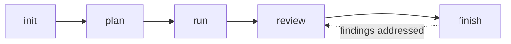
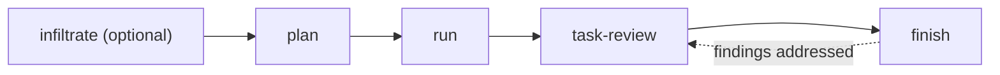

# dfc-dev-plugins

Two plugins for [Claude Code](https://claude.com/claude-code), also installable in Codex,
that turn agent time into reviewable pull requests. Both follow the same shape: plan first, let a human approve the plan, implement
in a worktree outside your checkout, open a draft PR, review it, and merge only on an
explicit approval of the exact commit.

| Plugin | Use it for | Unit of work |
|---|---|---|
| [`dev-autofix`](plugins/dev-autofix/README.md) | A backlog of small, pre-verified fixes, landed on leftover Claude subscription budget. | Many small draft PRs per run, one fix each, under a diff cap. |
| [`dev-autotask`](plugins/dev-autotask/README.md) | One large task (a feature, a refactor, or remediation of a local security audit). | One branch and one PR per task. |

## How the pieces fit

**dev-autofix**, many small fixes:



**dev-autotask**, one large task:



| Step | dev-autofix | dev-autotask | Runs in | What you do before the next step |
|---|---|---|---|---|
| Set up | `/dev-autofix:init` | (`plan` writes the config if none exists) | Claude Code | Confirm the detected repos, base branch and checks. |
| Plan | `/dev-autofix:plan` writes a queue of one-PR fix plans | `/dev-autotask:plan` writes one `plan.md` | Claude Code | Read the plan. Running the next step is the approval. |
| Implement | `/dev-autofix:run` opens one draft PR per fix | `/dev-autotask:run` opens one draft PR | Claude Code | Nothing; it stops when the PRs are open. |
| Review | `/dev-autofix:review` or `$review` | `$task-review` or `/dev-autotask:task-review` | Codex or Claude Code | Read the findings, or review by hand instead. |
| Finish | `/dev-autofix:finish` addresses findings, or merges an approved head | `/dev-autotask:finish` addresses findings; `finish <id> merge` merges | Claude Code | Re-run review after any new commit. |
| Check in | `/dev-autofix:status` | `/dev-autotask:status` | Claude Code | Nothing; both are read-only and name the next command. |

The two plugins are independent, and you can install either one alone. They share one
config file, `autofix.config.json`, so a workspace configured for one works with the other.
`dev-autotask:plan` also reads the dev-autofix backlog for work that was too large for a
small fix.

Nothing reviews or merges on its own. Every step is a command you run, and each one stops
and tells you the next.

## Requirements

These plugins encode one team's workflow. They expect:

- **Claude Code** for planning, implementing and finishing. **Codex** is recommended as an
  independent reviewer; both review skills also run in Claude Code.
- **GitHub** repositories, with [`gh`](https://cli.github.com) authenticated and allowed to
  push branches and open PRs.
- **Git 2.36 or newer**, with commit signing configured (SSH or GPG). `dev-autofix` refuses
  to push an unsigned commit; `dev-autotask` follows each repository's own signing rules.
- **Node.js 20 or newer** and `jq`, on **macOS or Linux**. The helper scripts use
  `/bin/sh`, `ps` and POSIX process groups, so on Windows use WSL.
- An **integration branch** such as `staging` that PRs target. Never point these plugins at
  a production branch.
- Fast, non-interactive **lint, typecheck and test commands** per repository. The defaults
  (install command, lockfile names, protected config files) assume npm; other package
  managers and languages work when you set `install`, `lockfile` and `verify` yourself.
- For `dev-autofix` budget gating: a Claude subscription plan that reports rate limits, and
  the [status line snapshot](plugins/dev-autofix/statusline/README.md). Without one,
  `/dev-autofix:run` still works with an explicit `max=N`.

## Install

Claude Code runs most skills and Codex is the main reviewer, so install in both.

Claude Code:

```
/plugin marketplace add DigitalFuelCapital/dfc-dev-plugins
/plugin install dev-autofix@dfc-dev-plugins
/plugin install dev-autotask@dfc-dev-plugins
```

Codex:

```bash
codex plugin marketplace add DigitalFuelCapital/dfc-dev-plugins
codex plugin add dev-autofix@dfc-dev-plugins
codex plugin add dev-autotask@dfc-dev-plugins
```

Start a new Codex thread after installing; a running thread keeps the skills it loaded.
Then follow each plugin's quickstart:
[dev-autofix](plugins/dev-autofix/README.md#quickstart),
[dev-autotask](plugins/dev-autotask/README.md#quickstart).

## Update

Neither tool updates automatically. After a release, update **both**, or Codex keeps
reviewing with the old skills.

Claude Code:

```
/plugin marketplace update dfc-dev-plugins
/reload-plugins
```

After updating `dev-autofix`, run `/dev-autofix:init` once more. It refreshes the copied
budget snapshot writer, which a plugin update does not touch.

Codex (`codex plugin add` reinstalls the current version over the cached one):

```bash
codex plugin marketplace upgrade dfc-dev-plugins
codex plugin add dev-autofix@dfc-dev-plugins
codex plugin add dev-autotask@dfc-dev-plugins
```

Then start a new Codex thread. To check what Codex has installed, run
`ls ~/.codex/plugins/cache/dfc-dev-plugins/*/` (one version folder per plugin).

What changed in each release: [dev-autofix](plugins/dev-autofix/CHANGELOG.md),
[dev-autotask](plugins/dev-autotask/CHANGELOG.md).

## Reviewing in Codex with checks

Codex's default sandbox blocks network access, so a review cannot install dependencies.
The review still works, but it posts `Checks: not run` and merging then relies on GitHub
CI. To let reviews run lint, typecheck and tests themselves, start review sessions with
network enabled and leave everyday `codex` sessions unchanged.

1. Add this alias to your shell profile (`~/.zshrc` or `~/.bashrc`):

   ```bash
   # Codex with network in the workspace-write sandbox (for $review / $task-review)
   alias codex-review='codex -c sandbox_mode="\"workspace-write\"" -c sandbox_workspace_write.network_access=true'
   ```

2. Reload your shell (`source ~/.zshrc`) or open a new terminal.
3. Start a review session from the repo being reviewed, or from the folder that holds
   `autofix.config.json`:

   ```bash
   cd ~/path/to/repo
   codex-review
   ```

4. In that session, run `$task-review <PR URL>` for dev-autotask, or `$review` for a
   dev-autofix batch.

The network setting lasts only for that session. With network on, the repo's install, lint
and test scripts can make outbound connections, so use `codex-review` only for repos and
PRs you trust, and plain `codex` for everything else.

## Repository layout

```
.claude-plugin/marketplace.json     the marketplace: lists both plugins and their versions
plugins/<name>/.claude-plugin/      plugin manifest
plugins/<name>/skills/<skill>/      one SKILL.md per command (the instructions the agent follows)
plugins/<name>/scripts/             Node helpers the skills call for anything that must be deterministic
plugins/dev-autofix/scripts/lib/    the modules behind pr.mjs: queue, gate, publish, approval, land
plugins/<name>/tests/               node:test suites for the helpers
plugins/dev-autofix/references/     contracts shared by several skills (state, locks, the fix brief)
plugins/dev-autofix/schema/         JSON Schema for autofix.config.json (used by both plugins)
plugins/dev-autofix/examples/       a sample config and queue
plugins/dev-autofix/statusline/     the budget snapshot writer and an optional status line
```

The split is deliberate: a `SKILL.md` holds judgement (what to investigate, when to stop
and ask), and a script holds anything that must not depend on a model getting it right
(the push gate, approval binding, locks, merge verification).

## Development

The helpers have no dependencies, and the tests need nothing installed. Run them from
the repository root:

```bash
node --test plugins/*/tests/*.test.mjs tests/*.test.mjs    # or: npm test
```

The linter is the one thing that needs an install. It checks correctness only (undefined
or unused identifiers), not formatting:

```bash
npm ci
npm run lint
```

The plugin tests build real git fixtures, so they need Git 2.36+, `ssh-keygen` and a
committer identity (`git config --global user.name` and `user.email`). `tests/` holds
repository-level checks that the documentation, examples and manifests agree with the
code: versions match, Markdown links resolve, the example config and queue are valid, and
every helper command a skill names exists.

When you change a plugin:

1. Bump its version in **both** `plugins/<name>/.claude-plugin/plugin.json` and
   `.claude-plugin/marketplace.json`. Claude Code and Codex cache plugins by version, so an
   unbumped change never reaches installed copies. Edits to a `SKILL.md` count: they change
   what the agent does.
2. Add an entry to the plugin's `CHANGELOG.md`.
3. To try the change before publishing, register your checkout as the marketplace:
   `/plugin marketplace add /absolute/path/to/dfc-dev-plugins` in Claude Code, or
   `codex plugin marketplace add /absolute/path/to/dfc-dev-plugins` in Codex.

`plugins/dev-autofix/scripts/lib/gate.mjs` and
`plugins/dev-autotask/scripts/publish-check.mjs` contain malware indicator strings on
purpose, and their tests use some as fixtures. They are the push gate's detection patterns,
not infections; see [AGENTS.md](AGENTS.md).

## Contributing and security

See [CONTRIBUTING.md](CONTRIBUTING.md) for how to make a change. Report security problems
privately, as described in [SECURITY.md](SECURITY.md).

## License

MIT. See [LICENSE](LICENSE).
