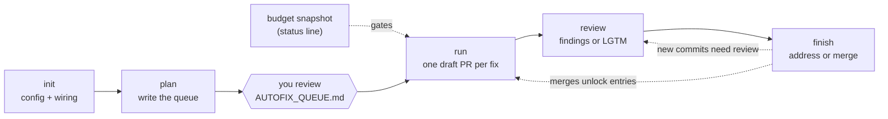

# Dev Autofix

Spends **leftover Claude subscription budget** on small, safe code fixes, landed as signed
draft PRs, then acts on your review of them.

The weekly budget resets whether or not you use it. If the window is at 60% on a Friday,
the other 40% expires. Autofix turns that into reviewed draft PRs for work you already
decided was worth doing, and stops at a reserve so it never eats the budget you need.

**Contents:** [How it works](#how-it-works) · [Requirements](#requirements) ·
[Install](#install) · [Quickstart](#quickstart) · [Commands](#commands) ·
[The queue](#the-queue) · [Reviewing and approving](#reviewing-and-approving) ·
[Configuration](#configuration) · [Safety model](#safety-model) ·
[State and recovery](#state-and-recovery) · [FAQ](#faq)

## How it works



| Piece | What it does |
|---|---|
| **Budget snapshot** | `statusline/usage-snapshot.mjs`, piped from your status line. It persists the rate limits that `plan` and `run` gate on. It is the data source, not decoration. |
| **`/dev-autofix:init`** | Setup. Detects repos, base branches and verification commands, writes `autofix.config.json`, and wires up the budget snapshot. |
| **`/dev-autofix:plan`** | Research. Investigates the repos, verifies every finding against the base branch, and writes a backlog of one-PR fix plans. |
| **`/dev-autofix:run`** | Execution. Reads the budget, takes plans off the backlog, fixes them in a reusable worktree, gates each branch, opens one draft PR each, and stops at the reserve. |
| **`/dev-autofix:review`** | Review. Walks every PR from the last run without prompting, validates in the existing worktrees, and posts findings or an exact `LGTM`. Works in Codex as `$review`. |
| **`/dev-autofix:finish`** | Follow-through. Reads the review on each PR. Findings: an Opus worker addresses them and the lead gates and pushes. An approval of the current head: verifies it against the latest base and merges it. |

Planning and fixing are separate on purpose. Planning is expensive, reads widely and needs
judgement. Fixing is cheap, reads one plan and needs obedience. Splitting them means the
fix loop never burns budget re-deriving what to do, and **you review the backlog before any
code is written**.

Two roles appear throughout. The **lead** is the session you invoked the skill in. A
**worker** is a subagent the lead spawns for one fix. Workers edit, verify and commit; only
the lead pushes, comments and merges, and only after a scripted gate passes.

## Requirements

- **Claude Code** for `init`, `plan`, `run` and `finish`. `review` runs in Claude Code or
  Codex.
- **GitHub** repos, with `gh` authenticated and allowed to push branches and open PRs.
- **Git 2.36+** with commit signing configured (SSH or GPG). For SSH signing, set
  `gpg.ssh.allowedSignersFile`, or the push gate cannot verify your commits.
- **Node.js 20+**, `jq` and `shasum`, on macOS or Linux (WSL on Windows).
- Repos with **non-interactive lint, typecheck and test commands**. The defaults assume
  npm (`npm ci --ignore-scripts`, `package-lock.json`); set `install` and `lockfile` per
  repo for anything else.
- For budget gating: a **Claude subscription plan** that reports rate limits. Without one,
  `/dev-autofix:plan` still works and `/dev-autofix:run` needs an explicit `max=N`.
- For review alone: Codex or Claude Code, `gh`, and the config and run manifest that
  `init` and `run` produced. Review does not need the budget snapshot.

## Install

```
/plugin marketplace add DigitalFuelCapital/dfc-dev-plugins
/plugin install dev-autofix@dfc-dev-plugins
```

Then run `/dev-autofix:init` once per machine. Plugins cannot ship a status line, so init
wires up the budget snapshot for you: it copies the writer to `~/.claude/`, proposes the
one-line addition to your existing status line (or installs the bundled one), and adds
`refreshInterval`. It shows each change and asks before touching your global config.
`/dev-autofix:run` re-checks the wiring every time and tells you to re-run init if a plugin
update changed the writer. The manual steps are in
[statusline/README.md](statusline/README.md).

### Codex

Codex reads this repository's Claude-compatible marketplace and plugin manifests (see
[OpenAI's plugin documentation](https://developers.openai.com/plugins/build/plugins)).
With a current Codex CLI:

```bash
codex plugin marketplace add DigitalFuelCapital/dfc-dev-plugins
codex plugin add dev-autofix@dfc-dev-plugins
```

Start a new thread after installing, then invoke `$review` from the folder that holds
`autofix.config.json`, or from one of its repos.

Only `review` is written for Codex. It uses the config, run manifest and worktrees that
Claude's `run` produced, and needs no budget snapshot. `init`, `plan`, `run` and `finish`
contain Claude-specific setup, budget and worker instructions; installing the plugin in
Codex does not port them.

## Quickstart

```
/dev-autofix:init          # detect repos, write autofix.config.json, check budget wiring
/dev-autofix:plan          # fill the backlog with verified fix plans
                           # ... read AUTOFIX_QUEUE.md, resolve needs-human entries ...
/dev-autofix:run           # spend leftover budget landing ready entries as draft PRs
/dev-autofix:review        # review every PR from that run; post findings or LGTM
/dev-autofix:finish        # address findings, or merge PRs whose current head is approved
```

Repeat `review` and `finish` until every PR is merged or parked. Each `finish` that pushes
new commits needs another `review` before those commits can merge.

Do not run `run`, `review` or `finish` at the same time on one workspace. They share one
worktree per repo and take the same lock.

## Commands

| Command | Arguments | Notes |
|---|---|---|
| `/dev-autofix:init` | `[path-to-repo ...]` | With no paths, looks for git checkouts in the current directory and one level below. |
| `/dev-autofix:plan` | `[repo ...] [areas=N] [per-area=N]` | `areas`: investigators to run (max 6). `per-area`: plans each should produce (default 5). |
| `/dev-autofix:run` | `[repo ...] [reserve=N] [max=N] [model=NAME] [dry-run]` | Arguments override the config for this run only. |
| `/dev-autofix:review` (Codex: `$review`) | `[repo ...] [pr=N ...] [review-only]` | Defaults to every PR in the last run. |
| `/dev-autofix:finish` | `[repo ...] [pr=N ...] [dry-run]` | Defaults to every PR in the last run. |

Examples:

```
/dev-autofix:run reserve=25      # leave a quarter of the week untouched
/dev-autofix:run max=2           # cap at two PRs
/dev-autofix:run dry-run         # pick candidates and print the briefs, change nothing
/dev-autofix:run my-app          # one repo only
/dev-autofix:run model=haiku     # cheaper fix workers
/dev-autofix:review my-app       # review one repo's PRs from the last run
/dev-autofix:review pr=42        # an explicit PR; name the repo too if the number is ambiguous
/dev-autofix:review review-only  # review in chat, post no GitHub comments
/dev-autofix:finish dry-run      # show which PRs would be addressed vs merged
/dev-autofix:finish pr=42        # one PR only
```

## The queue

`/dev-autofix:plan` writes `AUTOFIX_QUEUE.md` next to the config. Each entry is one PR: the
problem with `file:line` evidence, exact steps, the checks that must pass, and the traps a
worker would otherwise fall into. See the
[example queue](examples/AUTOFIX_QUEUE.md).

`plan` and `run` lint the queue (`pr.mjs queue lint`) and stop on anything that would
break a helper, so a hand-edited queue is checked before it is used.

Read it between `plan` and `run`. An entry's `status` decides what happens to it:

| Status | Meaning |
|---|---|
| `ready` | A worker can execute it with no judgement calls. `run` takes these in order. |
| `needs-human (<decision>)` | Waiting on a decision only you can make. Never executed. Change it to `ready` once you have decided. |
| `blocked (<why>)` | A worker stopped (the plan no longer matched the code, a check failed, or the push gate refused the branch). Not retried automatically. |
| `pushed (<branch>, date)` | The branch is on the remote but its PR is not registered yet. The next `run` finishes the job. |
| `pr-open (PR #n, date)` | A draft PR is open. |
| `merged (PR #n, date)` | Merged into the base branch. This unlocks entries whose `after:` names it. |

Entries with `kind: security` are never executed, even after you mark them `ready`. Fix
those by hand. An entry whose `after:` names another entry waits until that entry is
`merged`; an open PR does not unlock it.

## Reviewing and approving

`/dev-autofix:review` (or `$review` in Codex) reviews all PRs in
`<worktreeRoot>/last-run.json`, one after another, and leaves one comment per PR under your
`gh` account: either findings, or exactly `LGTM`. A blocked PR is reported and the pass
continues. Review never fixes, pushes or merges.

You can also review by hand, with a PR comment, a review body or inline comments.

`/dev-autofix:finish` then classifies each PR by the comments from the configured
`reviewers` since its last follow-up:

- **Exactly one comment, and it is exactly an approve token** (`LGTM` or `/merge` by
  default): an approval. Finish merges only if it can prove the token was given for the
  PR's current head commit.
- **Anything else**, including "LGTM but rename X": feedback. A worker addresses it, the
  lead gates and pushes, and finish posts a follow-up comment listing what changed. Run
  review again afterwards.

How an approval is tied to a commit:

| Approval came from | Evidence finish uses |
|---|---|
| `/dev-autofix:review` | The record review saved when it posted `LGTM`, which names the reviewed commit. |
| A formal GitHub review | The review's `commit_id`. |
| A plain `LGTM` comment you typed | The branch's push history on GitHub. If that history is incomplete or ambiguous, the approval stays pending and finish says so. |

Before merging, finish tests the PR merged with the latest base locally (install, prepare
and verify), waits for CI, re-checks the approval, and merges that exact commit. The local
test merge is never pushed, so clean PRs can merge one after another in a single pass. If
the PR needs a conflict resolution, finish publishes it as a new commit, and that new head
needs another review.

## Configuration

`/dev-autofix:init` writes `autofix.config.json` at the workspace root: the common parent
of the repos (for example `~/code/`), so the config and queue never show up as untracked
files in a checkout. It is validated by [the schema](schema/autofix.config.schema.json),
and there is a [worked example](examples/autofix.config.json). Skills find the config in
the current directory or any ancestor, then in `~/.claude/autofix.config.json`.

Top-level settings:

| Key | Default | Purpose |
|---|---|---|
| `reservePercent` | `10` | Weekly budget to leave alone. A run stops at `100 - reservePercent`. |
| `fiveHourCeiling` | `90` | Stop when the 5-hour window reaches this percent used. |
| `maxFixesPerRun` | `5` | Cap on PRs opened by one `run`. |
| `perFixPercentEstimate` | `2` | Starting guess for what one fix costs, used to size parallel waves. |
| `maxSnapshotAgeSeconds` | `900` | How old a budget reading may be before `run` treats it as stale. |
| `workerModel` | `sonnet` | Model for fix workers. Planning uses the session's model. |
| `maxDiffLines` | `150` | Size cap for one fix. Larger work is blocked for re-scoping. |
| `fallbackSearch` | `false` | When on, a repo with an empty queue lets its worker pick its own fix. That skips your backlog review, so leave it off unless you mean it. |
| `sources` | `[]` | Audit documents the planner mines for candidates. Treated as dated leads and re-verified. |
| `forbidden` | `[]` | Hard rules appended to every worker and investigator brief. |
| `blockPatterns` | `[]` | Extra regular expressions that must not appear on any added line. A match stops the run. |
| `reviewers` | your `gh` login | Whose PR comments `finish` acts on. Comments from anyone else are ignored. |
| `approveTokens` | `["LGTM", "/merge"]` | Comments that mean "merge" when they are the only pending comment. |
| `mergeMethod` | `squash` | How `finish` merges: `squash`, `merge` or `rebase`. |
| `coAuthor` | none | Added as a `Co-Authored-By` trailer on every autofix commit. |
| `queuePath` | `AUTOFIX_QUEUE.md` | Backlog file, relative to the config's folder. |
| `worktreeRoot` | `~/.claude/autofix/worktrees` | Where worktrees and run state live. Must be outside every checkout. |
| `usageSnapshotPath` | `~/.claude/usage/latest.json` | Where the status line writes the budget snapshot. |

Per-repo settings (`repos[]`):

| Key | Default | Purpose |
|---|---|---|
| `name` | required | Short identifier, used for the worktree folder and in reports. |
| `path` | required | Absolute path to your checkout. Never modified. |
| `remote` | required | GitHub `owner/repo`. |
| `baseBranch` | required | What PRs target. Use the integration branch (for example `staging`), never production. |
| `verify` | required | Commands that must pass before a PR opens or merges. Keep them fast and non-interactive: nothing that starts a server, needs a secrets manager, or touches a database. |
| `install` | `npm ci --ignore-scripts --no-audit --no-fund` | Dependency install, run in a fresh worktree or when the lockfile changes. Install scripts stay off by default because that is how a poisoned dependency runs code. |
| `lockfile` | `package-lock.json` | File hashed to decide whether to reinstall. |
| `prepare` | `[]` | Codegen a fresh worktree needs before typecheck passes. |
| `testCommand` | none | Template with `{files}` for running only the tests that cover changed files. |
| `commandTimeoutSeconds` | `600` | Timeout for each install, prepare and verify command (1 to 3600). Commands run with `CI=1`; a timed-out command is killed and recorded as a failure. |
| `forbidden` | `[]` | Hard rules for this repo. Put its `CLAUDE.md` or `AGENTS.md` rules here: workers start with a fresh context and will not otherwise know them. |
| `branchPrefix` | `fix/auto` | Branches are `<branchPrefix>-<yyyymmdd>-<slug>`. |
| `env` | `[]` | Names (never values) of environment variables to pass to install, prepare and verify commands. Everything else in your shell is withheld; see [Safety model](#repo-commands-run-with-a-minimal-environment). |

## Safety model

This plugin writes code and pushes branches, so the boundaries are explicit.

### What each command is allowed to do

| Command | Invoking it authorizes | It never |
|---|---|---|
| `run` | `branchPrefix` branches, signed commits on them, pushing them, and draft PRs against `baseBranch`. | Merges, pushes to the base branch, force-pushes, or touches your checkouts. |
| `review` | One top-level PR comment per reviewed PR (findings or `LGTM`), and temporarily checking PR commits out in the existing run worktrees. | Fixes, commits, pushes, merges, changes draft state, or removes worktrees. |
| `finish` | Signed commits and fast-forward pushes to a PR's own branch, PR comments, and, only for an approved current head, marking the PR ready and merging it, then cleaning up the merged branch. | Overwrites a remote branch, pushes to the base branch, merges without an approval, or acts on comments from people outside `reviewers`. |

`review-only` makes review post nothing. A do-not-merge instruction stops it from posting
approve tokens. For finish to act on a review, the account that posted it must be in
`reviewers`, and `approveTokens` must include `LGTM`.

### Your checkouts are never touched

Fixes happen in one shared worktree per repo under `worktreeRoot`, outside every checkout.
(A worktree nested inside a repo would be swept up by that repo's `tsc`, ESLint and Vitest
globs.) `run`, `review` and `finish` take the same lock before using it. A guard refuses
the wrong repository, a dirty tree, an in-progress Git operation, or commits that no ref
retains. Nothing is ever reset, cleaned or force-removed. A known failed attempt is moved
intact to a recovery folder so the next fix starts from a fresh tree; changes of unknown
origin are left where they are and reported.

### The push gate

Workers never push. The lead pushes only after `scripts/pr.mjs gate` passes on the branch.
It checks every outgoing commit, not just the net diff:

- **Files.** No commit touches `.gitignore`, `.env*`, a lockfile, `package.json`,
  `.github/`, `.husky/`, a shell or Windows script, or a build or lint tool config
  (`postcss`, `eslint`, `next`, `vite`, `tsconfig`, `wrangler`, `.graphqlrc`), and none
  makes a file executable. These are the files supply-chain malware commonly targets.
- **Size.** The diff is within `maxDiffLines` (or the entry's stated size plus 50%, if
  larger). Moved code counts once: a branch over the cap still passes when it is within
  the cap after discounting lines moved as blocks of three or more, and its raw size is
  within 1.5 × `maxDiffLines`. The PR body says when that happened.
- **Malware signatures.** No added line matches a built-in signature or a `blockPatterns`
  entry. A match stops the whole run and tells you to treat the machine as suspect. The
  built-in list includes generic constructs such as `eval(`, `new Function(` and
  `createRequire`, so a legitimate fix that needs one of those must be done by hand.
- **Signed.** Every commit passes `git verify-commit`.
- **Clean.** Nothing is left uncommitted.

A refused branch stays local in the worktree, unpushed, and the report lists it with the
failing check. Finish applies the same gate to the commits it adds, and also checks that
any merge commit only brings in the base branch.

### Repo commands run with a minimal environment

When a helper runs a repo's install, prepare or verify command (preparing a worktree,
validating a review, verifying a merge), the command gets `CI=1`, `PATH`, `HOME`, and
locale, temp and package-manager cache variables. Nothing else from your shell is passed
through, so a repo script or a poisoned dependency cannot read `GH_TOKEN` or an API key.
If a command needs a variable, list its name in the repo's `env`. Credentials in files
under `HOME` (such as `~/.npmrc`) keep working. Commands a fix worker runs itself use the
worker's own shell.

### What workers are barred from

Starting dev or preview servers, running browser or e2e tests, deploying, creating or
running migrations, touching secrets, changing dependencies, acting on anything filed
under a security heading, bare `git stash`, unsigned commits, `--no-verify`, force-pushing
and pushing to the base branch. The full text is in
[references/fix-brief.md](references/fix-brief.md).

### Merging

Every PR is opened as a draft: one concern, under the diff cap, with the repo's own
verification passing. `run` never merges. `finish` merges only when you approved the exact
PR head, its integration with the latest base passes locally, and CI and branch rules
allow it. Branch protection still applies: a strict up-to-date rule can require a sync
(which needs another review), and a merge queue stays pending until GitHub confirms the
merge.

### Budget gating fails closed

A run stops if the snapshot is missing, stale, or shows the reserve reached. Parallel
waves are sized from twice the largest per-fix cost seen so far. That limits the risk of
crossing the reserve but cannot rule it out, because one fix's cost is not known in
advance. The reserve is the buffer, so size it accordingly.

### Risky work is quarantined, not attempted

The planner marks an entry `needs-human`, with the specific decision written out, when it
changes observable behaviour, touches auth or crypto, changes dependencies, needs a file
the gate refuses, or deletes code on weak evidence.

## State and recovery

Everything the skills remember lives under `worktreeRoot`
(`~/.claude/autofix/worktrees` by default):

| Path | Contents |
|---|---|
| `<repo.name>/` | The shared worktree for that repo. |
| `last-run.json` | The run manifest: the PRs the last run opened. `review` and `finish` default to this batch. |
| `runs/` | Earlier manifests, archived when a new run replaces `last-run.json`. |
| `.locks/` | The run lock and one lock per repo. |
| `plans/`, `briefs/`, `pr/` | Planner notes, worker briefs, and PR title and body files. |
| `review/records/` | Durable review state and approval records. |
| `review/scratch/` | Prepared comments, command logs and other temporary output. |
| `recovery/` | Failed attempts, moved aside intact. Never cleaned up automatically. |

The deterministic steps are scripts, not prompts:

| Script | Owns |
|---|---|
| [`scripts/state.mjs`](scripts/state.mjs) | Platform and Git version check, config check, locks, the worktree guard, PR registration, recovery, approval records. |
| [`scripts/preflight.mjs`](scripts/preflight.mjs) | Delivery prerequisites: `gh` identity and write access, the remote base, a signing probe. |
| [`scripts/pr.mjs`](scripts/pr.mjs) | The queue (including `queue init` and `queue lint`), worker briefs, the push gate, publishing, approval evidence, landing and cleanup. |
| [`scripts/review.mjs`](scripts/review.mjs) | Review's local checks at the exact PR head. |
| [`scripts/merge.mjs`](scripts/merge.mjs) | Local integration verification before a merge. |

The model still reviews code and decides what to report. The full contract between the
skills and these scripts is in [references/workflow-state.md](references/workflow-state.md).

**Interrupted sessions.** Locks do not expire and are never stolen after a timeout. An
interrupted session can leave a lock and unfinished work behind. The lock records the
owning Claude or Codex process, its start time, the host and the session. Use
`state.mjs inspect-lock`, `resume-lock` (same session, after context compaction) or
`break-lock` (after confirming the previous session and its workers stopped), as described
in the [shared contract](references/workflow-state.md#config-and-ownership).

**Recovery folders.** `state.mjs list-recovery <config-file>` lists preserved worktrees and
the disk space they use, dependencies included. Run and finish include it in their
reports. Nothing there is deleted for you.

**Uncertain PR creation.** If a branch was pushed but the PR could not be confirmed, the
entry stays `pushed`. The next run looks the PR up and registers it before continuing.

## FAQ

**Does it merge anything?** Only through `/dev-autofix:finish`, when an exact approve
token is bound to the current PR head, local integration with the latest base passes
verification, and CI and branch rules allow merging. Nothing is pushed directly to the
base branch or force-pushed over existing work.

**What if the queue is empty?** With `fallbackSearch` off (the default), the repo is
skipped and the report tells you to run `/dev-autofix:plan`.

**What if a plan no longer matches the code?** The worker stops and reports `plan did not
hold`, and the lead marks the entry `blocked`. Several blocked entries in one run means the
base moved and the queue needs re-planning.

**What happens to a branch the gate refuses?** It stays local in the worktree, unpushed,
and the report lists it with the failing check so you can inspect it.

**Review posted `LGTM` but finish did not merge. Why?** Finish reports a classification
per PR. `stale` means the approval was for an earlier commit; review the new head.
`evidence-unavailable` means the approval could not be tied to a commit (for example the
comment was edited, or GitHub's push history is incomplete). Finish leaves it pending;
delete that comment and approve again with `/dev-autofix:review` or a formal GitHub
review. `address` means the approval was not the only pending comment, or was not an exact
token, so it was treated as feedback.

**`run` says the snapshot is stale.** A budget reading only refreshes when a session gets
an API response; an idle status line refresh does not count. Send any message in the
session and re-run. See [statusline/README.md](statusline/README.md).

**`run` says the writer differs.** A plugin update changed the snapshot writer. Run
`/dev-autofix:init` to copy the new one.

**A verify command passes in my terminal but fails under autofix.** It probably reads
an environment variable. Helpers run repo commands with a minimal environment; add the
variable's name to the repo's `env` list.

**The config check says my Git is too old.** The helpers need Git 2.36 or newer. Check
`git --version`; on Ubuntu 22.04 the packaged Git is 2.34, so install a newer one.

**Why keep "draft" out of PR titles?** Some review bots skip anything that looks
draft-titled. The PR itself is still opened as a draft.

## Upgrading

Release notes are in [CHANGELOG.md](CHANGELOG.md). After any update, run
`/dev-autofix:init` to refresh the copied budget writer. Upgrading from 2.x requires at
least one nonempty `verify` command for every repo.

## Development

Run the test suite from the repository root. The tests build real git fixtures, so they
need Git 2.36+, `ssh-keygen` and a committer identity:

```bash
node --test plugins/dev-autofix/tests/*.test.mjs
```

## License

MIT - see [LICENSE](LICENSE).
