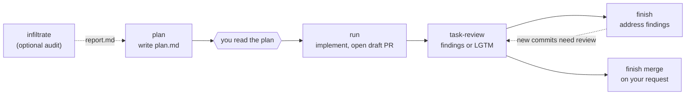

# Dev Autotask

Take one large development task from plan to merge as one branch and one PR. Claude plans,
implements and finishes; Codex reviews. GitHub holds most of the state: the PR, its head
commit, CI, and `gh pr merge --match-head-commit`.

Use it for work that is too big for a small automated fix: a feature, a multi-file
refactor, a migration, or remediation of a security audit. For a backlog of small fixes,
use [dev-autofix](../dev-autofix/README.md).

**Contents:** [How it works](#how-it-works) · [Requirements](#requirements) ·
[Install](#install) · [Quickstart](#quickstart) · [Commands](#commands) ·
[Security audit](#security-audit) · [Rules](#rules) · [Configuration](#configuration) ·
[Where state lives](#where-state-lives) · [FAQ](#faq)

## How it works



1. **Plan.** `/dev-autotask:plan [repo:] <request or report path>` investigates the code
   and writes `plan.md` with acceptance criteria, scope, milestones and validation. It
   shows the plan and stops. Ask for changes, or approve by running the next step.
2. **Run.** `/dev-autotask:run <id>` implements the plan in a dedicated worktree, runs the
   configured checks, pushes, opens one draft PR, and stops.
3. **Review.** `$task-review <pr>` in Codex reviews the PR against its plan, runs the
   checks if it can, and posts one comment: findings, or `LGTM`, with the commit it
   reviewed. `/dev-autotask:task-review` does the same in Claude Code.
4. **Finish.** `/dev-autotask:finish <id>` addresses findings and pushes; go back to
   step 3. Once the current head has an `LGTM`, `/dev-autotask:finish <id> merge` merges
   it.

Nothing reviews or merges automatically. Each step stops and tells you the next one.

## Requirements

- **Claude Code** for `infiltrate`, `plan`, `run` and `finish`. **Codex** (or Claude Code)
  for `task-review`.
- **GitHub** repos, with `gh` authenticated and allowed to push branches and open PRs.
  `finish` acts on review comments from the account `gh` is logged in as, so either use
  the same GitHub account in Claude Code and Codex, or list the reviewer's login under
  `reviewers` in the config.
- `git`, **Node.js 20+**, on macOS or Linux (WSL on Windows).
- At least one fast, non-interactive **verify command** per repo (lint, typecheck, test).
- An **integration branch** for PRs to target.

## Install

```text
/plugin marketplace add DigitalFuelCapital/dfc-dev-plugins
/plugin install dev-autotask@dfc-dev-plugins
```

### Codex

Install the same plugin in Codex for the review step:

```bash
codex plugin marketplace add DigitalFuelCapital/dfc-dev-plugins
codex plugin add dev-autotask@dfc-dev-plugins
```

Start a new thread and invoke `$task-review` from the folder that holds
`autofix.config.json` (or with the config in `~/.claude/`).

Review runs the checks in a temporary worktree. Give Codex a sandbox that allows that, or
the review reports `Checks: not run`; see
[Reviewing in Codex with checks](../../README.md#reviewing-in-codex-with-checks).

Only `task-review` is written for Codex. `infiltrate`, `plan`, `run` and `finish` are
Claude Code workflows.

## Quickstart

```text
/dev-autotask:plan my-app: add CSV export to the orders page
                                   # ... read plan.md; ask for changes or continue ...
/dev-autotask:run add-csv-export   # implement, verify, open one draft PR
$task-review 123                   # in Codex: findings, or LGTM for the reviewed commit
/dev-autotask:finish add-csv-export          # address findings, push; then review again
/dev-autotask:finish add-csv-export merge    # merge once the current head has an LGTM
```

Not sure what to work on? Run `/dev-autotask:plan` with no request. It investigates the
repo itself and proposes up to five verified, multi-file tasks that are too large for
dev-autofix (duplicated logic, gaps between docs and code, untested critical or risky
paths, half-done migrations), then waits for you to pick one.

## Commands

| Command | Arguments | What it does |
|---|---|---|
| `/dev-autotask:infiltrate` | `[repo:] [areas or objective]` | Local security audit with cross-verified findings. Writes `report.md`. |
| `/dev-autotask:plan` | `[repo:] [id=<task-id>] [request, or path to a report]` | Writes `plan.md` and stops. With no request, suggests tasks. Pass `id=` to name the task or to replan an existing one. |
| `/dev-autotask:run` | `[repo:]<task-id>` | Implements the plan and opens one draft PR. Resumes an interrupted task. |
| `/dev-autotask:task-review` (Codex: `$task-review`) | `[pr-number or URL]` | Posts one comment: findings, or `LGTM` with the reviewed head. |
| `/dev-autotask:finish` | `[repo:]<task-id> [merge]` | Addresses the latest review. With `merge`, merges an approved current head. |

`repo:` is a repo name from the config followed by a colon, for example
`my-app: add CSV export`. Commands otherwise use the repo that contains the current
directory, or the only configured repo; if that is ambiguous they ask.

## Security audit

`/dev-autotask:infiltrate [objective]` is an optional step before planning. Three Claude
agents each audit one area of a detached checkout of `origin/<baseBranch>`, then each
tries to disprove another agent's findings. `scripts/audit.mjs` merges their output into a
local `report.md`. A finding counts as **confirmed** only when a different agent confirmed
it and none rejected it; the rest are listed as disputed, unverified or rejected.

Agents inspect code and run proofs of concept only in throwaway copies with an empty
environment. Nothing touches deployed systems, and nothing leaves your machine.

Remediate with `/dev-autotask:plan <report.md> [finding IDs]`, then follow the normal
flow. `plan` re-checks each finding against the current base and drops any that are
already fixed. Before pushing a security fix, `run` checks the repository's visibility and
asks first if it is public, because the fix and its tests disclose the vulnerability.

A report with no confirmed findings means none were established in the audited scope. It
does not mean the repository is secure.

## Rules

- One task, one branch (`dev/autotask-<id>`), one PR. Resuming reads `task.json`; it never
  opens a second PR.
- Never force-push, never push to the base branch, never edit or switch your main
  checkout.
- Merge only on an explicit request, and only when an `LGTM` comment's `Reviewed head`
  equals the current PR head (`gh pr merge --match-head-commit`). Never `--admin`.
- Any new commit after an `LGTM` needs another `$task-review`.
- Production deployments and migrations are out of scope. Merging a task does not
  authorize them.

How this differs from dev-autofix: there is no budget gate, and no gate that refuses
protected files, because a large task may legitimately change `package.json` or CI. The
safeguards here are the plan you approve, the checks, the independent review, and a merge
pinned to the reviewed commit, plus two scripted guards:

- **A task lock.** `run` and `finish` take a per-task lock, so two sessions cannot work on
  one task at once. A lock left by a crashed session is replaced only after you confirm.
- **A publish check before every push.** `scripts/publish-check.mjs` refuses uncommitted
  work, a credential or `.env` file in any commit, a known malware signature, and an
  unsigned commit in a repository that has `commit.gpgsign` on. It also lists the
  sensitive files the branch touches (CI, dependency manifests, lockfiles, scripts, build
  files) so they are called out in the PR.

## Configuration

dev-autotask uses `autofix.config.json`, the same file
[dev-autofix](../dev-autofix/README.md#configuration) uses. It looks for the nearest one
from the current directory upward, then `~/.claude/autofix.config.json`. One file can list
every repo under a workspace folder.

If no config exists, `plan` detects the repos and writes one in dev-autofix's format
([schema](../dev-autofix/schema/autofix.config.schema.json)), so dev-autofix can use it
too. You do not need dev-autofix installed.

Per repo, dev-autotask reads:

| Key | Default | Purpose |
|---|---|---|
| `path`, `remote`, `baseBranch` | required | Your checkout, the GitHub `owner/repo`, and the branch PRs target. |
| `verify` | required | At least one command that must pass before publishing. |
| `install` | `npm ci --ignore-scripts --no-audit --no-fund` when the checkout has a `package.json`, otherwise none | Dependency install. |
| `prepare` | `[]` | Codegen to run before the checks. |
| `commandTimeoutSeconds` | `600` | Timeout for each command. |
| `forbidden` | `[]` | Hard rules for this repo, added to the top-level `forbidden` list. |
| `env` | `[]` | Names of environment variables to pass through to the checks (dev-autofix honours it too). |

It also reads two top-level settings shared with dev-autofix: `reviewers` (GitHub logins
whose review comments `finish` acts on; default: the account `gh` is logged in as) and
`disabledPatterns` (ids of built-in malware signatures to switch off in the publish
check).

`node scripts/verify.mjs <dir> <config> <repo-name>` runs install, prepare and verify
with a per-command timeout and a **minimal environment**: `CI=1` plus `PATH`, `HOME`,
locale, temp and package-manager cache variables. Tokens in your shell are not passed
through. Commands that need credentials must read them from files under `HOME` (for
example `~/.npmrc`), or you can list the variable names in the repo's `env`, for example
`["DATABASE_URL", "NPM_TOKEN"]`. Only names go in the config, never values.

## Where state lives

Task state lives under `~/.claude/dev-autotask`, which must be outside every configured
checkout. It is namespaced by GitHub repository, so the same task ID can exist in two
repos; pass `<repo>:<id>` to choose.

```text
~/.claude/dev-autotask/
  tasks/<owner>/<repo>/<id>/task.json    id, title, config, repo, remote, baseBranch, branch, worktree, pr, progress
  tasks/<owner>/<repo>/<id>/plan.md      the plan you approved
  tasks/<owner>/<repo>/<id>/lock.json    present while a session is working on the task
  worktrees/<owner>/<repo>/<id>/         the task worktree
  audits/<owner>/<repo>/<audit-id>/      infiltrate notes, findings.json, report.md
```

After a merge, `finish` removes the task worktree and marks the task done. The records,
the plan and the local branch stay in place. `node scripts/state.mjs list` shows every
task with its PR, whether it is done, and whether a worktree or lock remains.

## FAQ

**How do I change a plan?** Tell Claude what to change and re-run
`/dev-autotask:plan` with the same task ID. Running `run` is the approval.

**`run` was interrupted. What now?** Run it again with the same ID. It resumes in the
existing worktree, keeps uncommitted work, and reads the recorded progress.

**`finish` says the LGTM is for an older head.** A commit landed after the review. Run
`$task-review` again; approvals never carry over to new commits.

**The review says `Checks: not run`.** The reviewer could not run the checks, usually
because of the Codex sandbox. `finish ... merge` warns you and then relies on GitHub's
required checks. To have the reviewer run them, see
[Reviewing in Codex with checks](../../README.md#reviewing-in-codex-with-checks).

**`run` or `finish` says the task is locked.** Another session is working on it, or one
crashed while it was. If you are sure that session has ended, say so and Claude will
replace the lock.

**I have a task from dev-autotask 1.0.** Those records are not resumed. Re-plan the task.

## Development

```bash
node --test plugins/dev-autotask/tests/*.test.mjs
```

Release notes are in [CHANGELOG.md](CHANGELOG.md).

## License

MIT - see [LICENSE](LICENSE).
